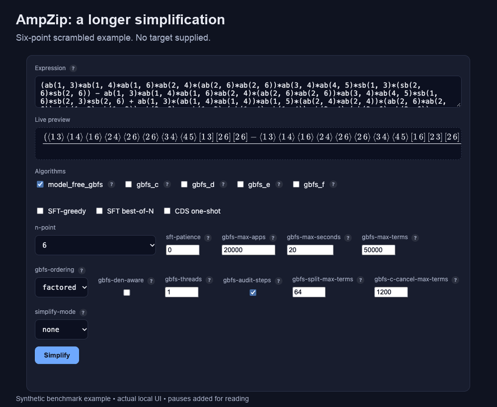
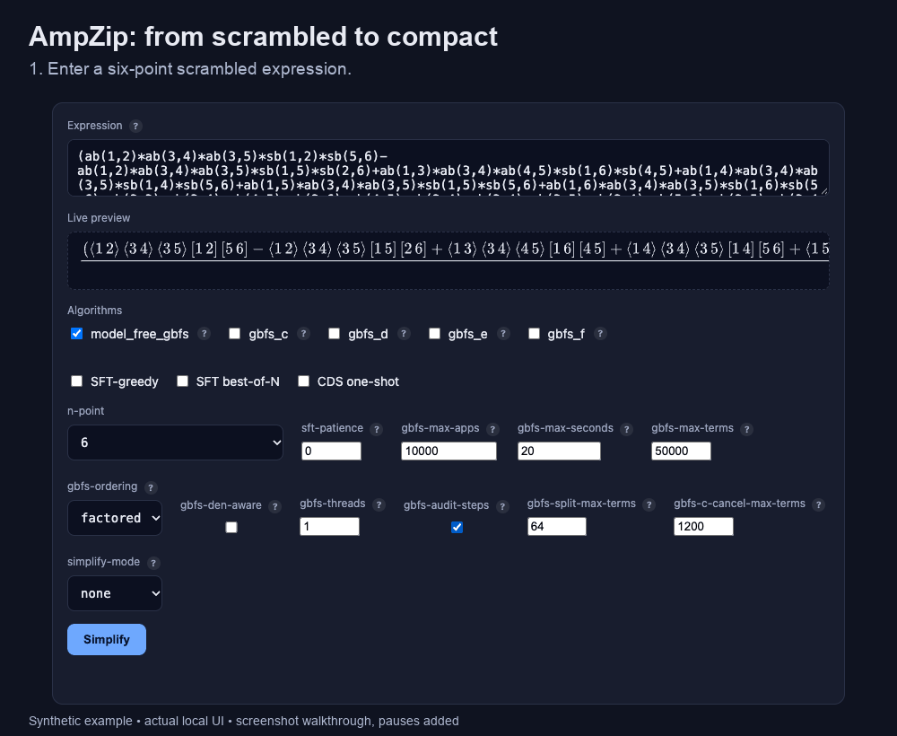

# AmpLens

Tools for revealing physical structure in scattering amplitudes.

AmpLens is a collection of tools for scattering amplitudes in spinor-helicity notation. It currently includes AmpZip, a simplifier for massless amplitudes. The `amplens` package installs the available components together.

| Component | Directory | PyPI | What it does |
|---|---|---|---|
| AmpZip | [`AmpZip/`](AmpZip) | `ampzip` (engine: `ampzip-engine`) | Simplifies four-, five- and six-point spinor-helicity expressions by greedy best-first search. |
| AmpLens | [`amplens/`](amplens) | `amplens` | Installs the components, lists their versions, and provides access to the AmpZip command-line interface. |

## AmpZip in action

Compress a long spinor-helicity expression and inspect the identities behind the result.



This six-point example goes from **14 numerator terms to one** through six recorded rewrites. Open **details** to see the identity used at each step. No target expression is supplied to the search.

[Copy the input](docs/demos/six-step-input.txt) · [Static image](docs/demos/six-step.png) · [Reproduce the demo](docs/demos/README.md) · [Run AmpZip locally](AmpZip/README.md#install)

<details>
<summary>A shorter example: 12 numerator terms to a single bracket</summary>



Two identity substitutions, together with algebraic collection and cancellation, reduce this expression to `ab(3,4)`.

[Copy the input](docs/demos/two-step-input.txt) · [Static image](docs/demos/two-step.png)

</details>

Both animations show synthetic scrambled examples in the local interface, with pauses added for reading. Each recorded rewrite passes finite-field consistency checks; the animations are demonstrations, not timing benchmarks.

## Install

```bash
pip install amplens             # AmpLens components
pip install 'amplens[web]'       # plus the AmpZip web service
pip install ampzip              # AmpZip alone
```

<!-- Confirm the platform list against the artifacts of the first release before publishing. -->
Binary wheels are provided for CPython 3.12 and later on Linux (x86_64, aarch64), macOS (Apple silicon, Intel) and Windows (x86_64). Building from source requires a Rust toolchain. See the [AmpZip README](AmpZip/README.md) for instructions.

## Layout

```
AmpLens/
├── AmpZip/        the AmpZip package, its engine, tests and documentation
├── amplens/       the meta package
├── paper/         input datasets and evaluation commands for the paper
└── .github/       release workflow (tags ampzip-v* and amplens-v*)
```

## Citation

If you use AmpZip, please cite its [paper and software](AmpZip/CITATION.cff).

## License

MIT, see [`LICENSE`](LICENSE).
